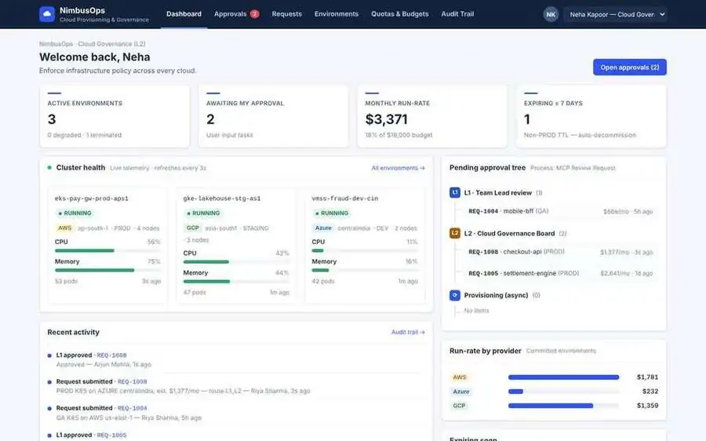
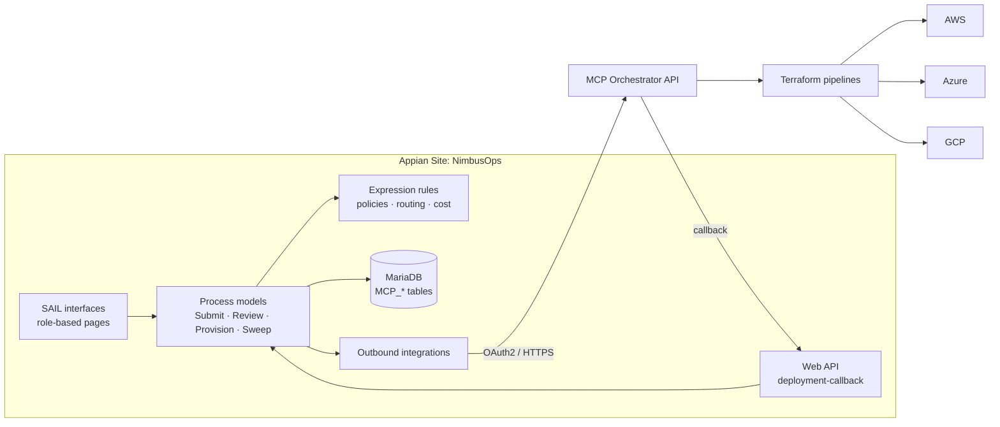
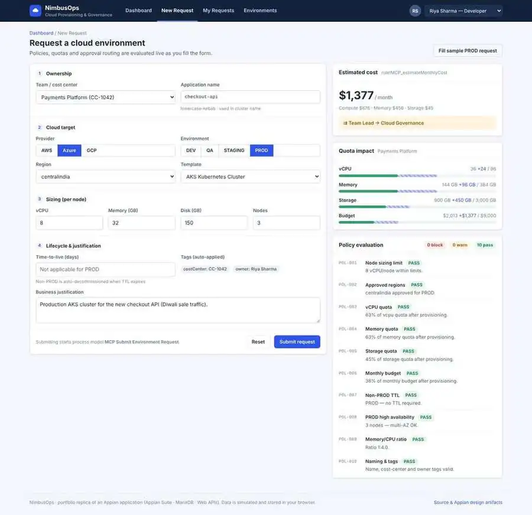
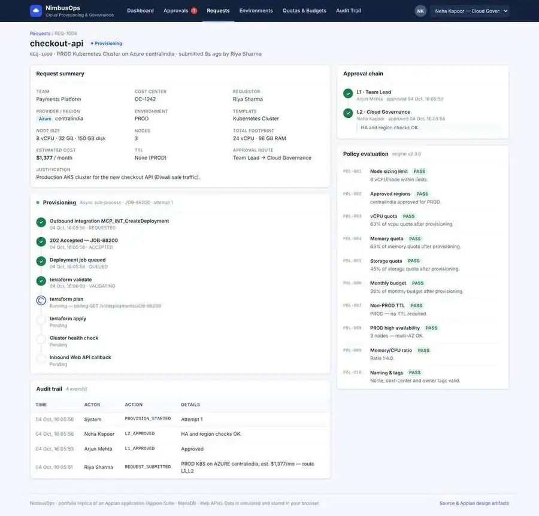

# NimbusOps: Multi-Cloud Provisioning & DevOps Governance

**Platform:** Appian Suite · MariaDB · Web APIs  **Timeline:** Sep 2025 – Oct 2026

NimbusOps is a cloud automation portal built the Appian way. Developers request cloud environments on AWS, Azure or GCP. The app checks each request against team quotas and infrastructure policies, sends it to the right approvers, and provisions it through outbound Web API integrations. It then tracks the asset through its lifecycle until it is decommissioned. Every step is written to an audit trail.

### 🔗 [Live demo](https://kmaan0786akwork-collab.github.io/multi-cloud-provisioning-portal/)

> Appian is a licensed low-code platform, so it can't be hosted on GitHub Pages. This repo has two parts:
> 1. **`/appian`**: the design artifacts: MariaDB schema, CDT definitions, SAIL expression rules and interfaces, process-model designs, and integration and Web API definitions.
> 2. **The web app at the repo root**: a working browser version of the Appian site. It uses the same data model, rules and process logic, so you can try it without an Appian licence. Data is simulated and kept in your browser's `localStorage`.



---

## What it does

| Capability | How it works |
|---|---|
| **Self-service requests** | A form with live cost estimates, quota impact and policy results that update as you type |
| **Quota & policy evaluation** | 10 policies (sizing, approved regions, vCPU/RAM/storage quota, budget, TTL, HA, memory:CPU ratio, naming) return PASS, WARN or BLOCK |
| **Dynamic approval routing** | `AUTO` → `L1 Team Lead` → `L1 + L2 Cloud Governance`, decided by environment, cost and warnings |
| **Async provisioning** | `POST /v1/deployments` → status polling → inbound Web API callback, with an exception flow and retry |
| **Lifecycle automation** | Non-PROD TTL, TTL extension (45-day cap), manual decommission, scheduled lifecycle sweep |
| **Real-time health** | SAIL-style dashboards with cluster CPU/memory, pod counts and a live log stream |
| **Audit tracing** | Append-only event log for every transition, with filters and CSV export |
| **Role-based UI** | Four personas, each with its own navigation, data scope and actions |

## Try the demo (2 minutes)

Use the persona switcher in the top-right corner:

1. **Riya Sharma (Developer)**: open *New Request* → *Fill sample PROD request* → *Submit*.
2. **Arjun Mehta (Team Lead)**: open *Approvals* → approve. The request goes to L2 because it is PROD.
3. **Neha Kapoor (Cloud Governance)**: approve, then open the request and watch the provisioning timeline run.
4. **Vikram Rao (Platform Admin)**: check *Integrations* for the HTTP call log (click a row to see the JSON). Turn on **Chaos testing** to force a provider failure, then retry it.

Try a DEV request with 2 vCPU × 1 node to see the **auto-approve** path. Raise vCPU above 32 on a non-PROD request to see a **BLOCK**.

## Resume bullets → where to find them

| Bullet | Appian artifact | Working implementation |
|---|---|---|
| **API orchestration**: outbound HTTP integrations & Web APIs | [`appian/integrations`](appian/integrations) (connected system, 4 integrations, inbound Web API, OpenAPI contract) | [`js/services.js`](js/services.js) → `MCP.Integrations` |
| **Data architecture**: CDTs & relational entities | [`appian/database/schema.sql`](appian/database/schema.sql) (12 tables, 3 views, append-only triggers) · [`appian/cdt`](appian/cdt) (6 XSDs) | [`js/data.js`](js/data.js) |
| **Automation logic**: expression rules with array filtering | [`appian/expression-rules`](appian/expression-rules) (`a!forEach`, `wherecontains`, `index`, `a!match`) | [`js/rules.js`](js/rules.js) → `MCP.Rules` |
| **SAIL dashboards**: role-based, real-time | [`appian/interfaces`](appian/interfaces) (cluster health, approval tree, review task) | [`js/ui.js`](js/ui.js) |
| **Process engineering**: async models with gateways | [`appian/process-models`](appian/process-models) (Mermaid diagrams for 4 models) | [`js/services.js`](js/services.js) → `MCP.Process` |

## Architecture



## Screenshots

| New request with live policy evaluation | Async provisioning timeline |
|---|---|
|  |  |

## Project structure

```
├── index.html               # Appian Site shell
├── css/styles.css           # SAIL-inspired styling
├── js/
│   ├── data.js              # Constants + seed data (mirrors CDTs)
│   ├── rules.js             # Expression rules (policies, routing, cost)
│   ├── services.js          # Store, audit, integrations, process engine
│   └── ui.js                # Interfaces / pages
├── appian/
│   ├── database/            # MariaDB schema + seed
│   ├── cdt/                 # Custom Data Type XSDs
│   ├── expression-rules/    # SAIL expression rules
│   ├── interfaces/          # SAIL interfaces
│   ├── process-models/      # Process model designs
│   └── integrations/        # Connected system, integrations, Web API, OpenAPI
└── docs/screenshots/
```

## Run locally

It has no build step and no dependencies:

```bash
git clone https://github.com/kmaan0786akwork-collab/multi-cloud-provisioning-portal.git
cd multi-cloud-provisioning-portal
python -m http.server 8000   # then open http://localhost:8000
```

To load the database:

```bash
mysql -u root -p < appian/database/schema.sql
mysql -u root -p < appian/database/seed.sql
```

---

Built by **Mohd Armaan** · [LinkedIn](https://www.linkedin.com/in/armaan-work) · [Portfolio](https://kmaan0786akwork-collab.github.io/Kinvara-health/)
