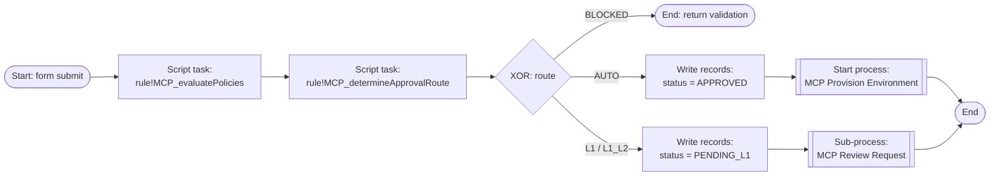
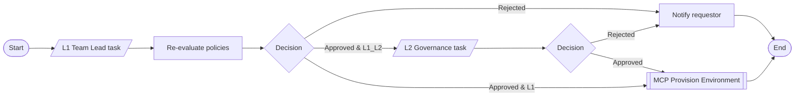
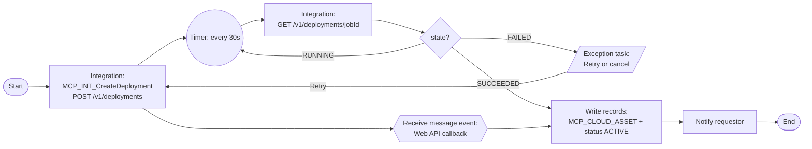

# Process models

Four process models drive the application. All write to `MCP_AUDIT_LOG` through the sub-process **MCP Write Audit Event** so every transition is traceable by `correlation_id` (the process instance id).

## 1. MCP Submit Environment Request

Started from the **New Request** form (site action).

## 2. MCP Review Request

| Node | Type | Assignment / logic |
|---|---|---|
| L1 review | User input task (`interface!MCP_ReviewRequestTask`) | Group `MCP L1 Approvers`, escalation after 24h |
| Re-evaluate policies | Script task | Re-runs `rule!MCP_evaluatePolicies` — quotas may have moved |
| Decision gateway | XOR | REJECTED → end · route `L1_L2` → L2 · else → provision |
| L2 review | User input task | Group `MCP L2 Approvers`, escalation after 48h |
| Notify | Integration `MCP_INT_PostNotification` | Requestor + channel |

## 3. MCP Provision Environment (asynchronous)

Long-running; designed so no node blocks an engine thread.

- **Activity chaining** is disabled after the integration node so the process goes asynchronous.
- **Inbound path**: the orchestrator calls `MCP_WebAPI_DeploymentCallback`, which uses `a!startProcess` / message correlation on `jobId`.
- **Polling fallback**: if the callback never arrives, the timer loop polls the status endpoint (max 60 attempts).
- **Exception flow**: provider errors (for example `InsufficientCapacity`) send an exception task to `MCP Administrators` with Retry / Cancel.

## 4. MCP Lifecycle Sweep (scheduled, daily 02:00 IST)

1. Query `MCP_VW_EXPIRED_ASSETS`.
2. Run **MCP Decommission Asset** for each row (MNI): `DELETE /v1/deployments/{assetId}` → asset `TERMINATED`, request `DECOMMISSIONED`.
3. Send a 48-hour expiry warning to owners of assets expiring soon.
4. Write a `LIFECYCLE_SWEEP` audit summary.
